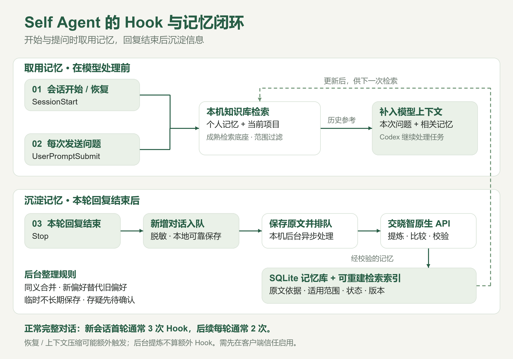

# Self Agent

让 Codex 和 Claude Code 在正常使用中自动积累、检索和修订长期记忆。知识保存在本机，交晓智负责后台提炼。

**[下载 Windows 一键安装包](https://github.com/hanhan761/self-agent/releases/tag/local-v0.2.1)**

## 安装与使用

1. 下载发行版中的 **Setup.exe**，双击安装。运行环境和中文检索模型随包提供。
2. 已登录 XJCode 时自动复用本机受保护凭据；否则在校园登录窗口登录交晓智，自动配置授权模型。
3. 重开智能体会话。Codex 首次需要在 **/hooks** 中审核并信任 Self Agent 的 Hook。

之后正常聊天即可。提问时先保存新增信息并检索相关记忆，回复结束后补采剩余对话，后台提炼和修订。不需要每次提醒“记住”、输入密钥、配对码或手动启动服务。

也可以把这句话发给有本机操作能力的智能体：

> 请按 https://github.com/hanhan761/self-agent/blob/main/docs/local-connect-agent.md 在当前设备安装 Self Agent 本地版，自动接入 Codex 和 Claude Code、保留其他设置，并验证连接；需要我完成校园登录或 Hook 信任审核时请如实说明。

管理内容时，从 **开始菜单 → Self Agent** 打开本机管理页，会自动登录。左侧切换全局或项目，中间筛选分组，右侧查看原话与历史；可以批量调整适用范围、写入、编辑或移出，导入和备份放在次级入口。有效的用户记忆默认自动加入，不必逐条审核。总览可查看每日新增柱状图，支持14/30天、日常与历史导入分开查看，详见 [统计口径](docs/daily-growth.md)。

首版支持 Windows 10/11 x64，面向本机 Codex 和 Claude Code。无需独立显卡、Docker、WSL、Node 或用户预装 Python；校园登录仍需要可达的交晓智服务。缺少 WebView2 时安装器按需准备微软官方运行时。

## Hook 与长期记忆的工作原理

| 事件 | 自动完成的工作 |
| --- | --- |
| SessionStart | 会话开始或恢复时，补采新增输入，再快速读取少量已确认的个人与项目默认约定 |
| UserPromptSubmit | 模型处理本次问题前，先可靠采集新增输入，再检索相关记忆 |
| Stop | 本轮回复结束后，将新增对话脱敏并可靠保存到本地队列 |

完整新会话首轮通常触发 3 次，后续每轮通常 2 次；恢复、压缩和中断会影响实际次数。后台提炼不是第四个 Hook，也不在每次工具调用后重复运行。

“越用越好用”来自有来源依据的记忆持续积累与修订：同义信息合并，明确的新偏好替代旧偏好，临时信息按期限失效，存疑内容待确认。它不会训练主模型参数，也不能保证模型判断永远正确。

[可编辑 SVG](docs/assets/self-agent-hooks.svg) · [图示生成脚本](ops/render_hook_diagram.py)

## 复用了什么

- **[MCP Memory Service 12.4.0](https://github.com/doobidoo/mcp-memory-service/tree/v12.4.0)**：直接调用上游混合检索（BM25＋向量）、语义重复候选查找、批量索引写入、SQLite-vec 范围隔离与 ONNX 编码。
- **[FlashRank 0.2.10](https://github.com/PrithivirajDamodaran/FlashRank)＋[BGE reranker base](https://huggingface.co/BAAI/bge-reranker-base)**：对最多 24 个候选作中英文相关性重排；使用离线 INT8 权重、CPU 两线程，无关时允许返回空。
- **[APScheduler 3.11.3](https://apscheduler.readthedocs.io/en/3.x/userguide.html)＋filelock**：独立执行采集、提炼和索引任务，限制并发并合并错过的调度；跨进程协调容量预留。
- **[detect-secrets 1.5.0](https://github.com/Yelp/detect-secrets/tree/v1.5.0)**：历史会话的离线凭据检测，结合现有脱敏与用户原话校验。
- **多语 MiniLM＋ONNX Runtime**：CPU 执行中文与跨语言检索；模型随包预装，运行时不自动更换模型。
- **XJCode 登录组件＋Windows DPAPI**：复用校园登录流程，在本机加密保存凭据；交晓智调用使用原生 HMAC API。
- **FastAPI、MCP SDK、SQLite、jieba、cryptography**：本地服务、智能体工具、权威记录、中文关键词与加密备份。

Self Agent 保留来源校验、项目隔离、记忆生命周期和客户端适配。现有 SQLite 是唯一权威内容库；MCP Memory Service 数据库是可重建检索投影，替换本地模式中的 Mem0/Qdrant，不另建一套权威记忆。详见 [复用边界与架构](docs/local-design.md)。Obsidian 不是运行依赖。

审阅与整理方式参考 Notion、Obsidian 等成熟知识库的属性视图与侧边详情，详见 [知识库管理](docs/review-management.md)。

## 数据与运行边界

- 原文、记忆、修订记录、队列和凭据位于仓库外的 Windows 私有目录。
- 检索在本机运行；脱敏后的待提炼内容仍会发送给交晓智，**不是完全离线**。
- 在明确配置的交晓智模型池内自动选择当前可用型号；故障时切换备用并在网页提示。提供商、账号及授权范围保持固定，详见 [模型切换与提醒](docs/provider-health.md)。
- 断网或模型权限失效时保留本地检索与采集；未发起的生成任务等待恢复。页面明确显示整理暂停和未完成资料，结果不明确的已发起生成不会盲目付费重放。详见 [整理健康状态](docs/provider-health.md)。
- 用户与项目范围、忘记和过期状态在权威库再次校验，旧索引不能复活已失效内容。
- 本次不包含跨设备自动同步；旧服务器部署保留，不因本机安装而停用。

## 大量记忆的保障

检索只取有限候选，再重排与校验；不会把全部记忆塞进提示词，也不会为了凑满条数返回无关结果。同义、冲突和被移出的历史记录由上游查候选，交晓智结合用户原话决定合并或替换，最终由 SQLite 事务执行。

队列默认上限 1,000 个批次／64 MiB、1,000 个待处理任务，磁盘至少保留 512 MiB。达到限制时暂停采集且不推进游标，空间恢复后补采；不自动删除知识。完整提炼结果先保存检查点，安全的索引延迟不会再次发起同一提炼请求。结果不明的模型调用仍需明确重试。

规模及相关性验证见 [压测结果](docs/scaling-acceptance.json)。这是隔离合成数据测试，不等同于百万条、长期连续运行或任意领域的质量保证。

显式授权后也可以补录本机历史会话，按原始时间、角色和项目整理；过滤一次性操作授权，范围存疑的内容保留为候选。详见 [历史吸收与实测](docs/history-import.md)。这项改进已进入源码，现有 local-v0.2.1 安装包尚未重新打包。

## 开发与验证

本地发行版锁定 MCP Memory Service 12.4.0／MCP SDK 1.30.0。现有服务代码也兼容此前的 SDK 2.3.0。

    python -m pip install -e ".[local,test]" -c requirements-local-windows.lock
    python -m pytest -q

高级本机初始化：已准备模型文件后，运行下列命令。普通使用请直接下载安装包。

    self-agent setup --local --client both --model-cache <模型目录>
    self-agent status
    self-agent repair
    self-agent open
    self-agent uninstall

卸载移除本实例的接入与自动启动配置，保留知识数据。安装和升级保留其他 MCP、模型配置及 Hook；原有设置会备份。

五个 MCP 工具保持兼容：memory_search、memory_get、memory_remember、memory_update、memory_forget；原有 /v1 API 与 v1/v2 导出格式继续支持。

验证记录见 [本地验收](docs/local-acceptance.json)，安装包制作见 [本地构建说明](docs/local-build.md)。宿主信任审核、完整真实模型调用、Hook 子进程验证和浏览器验证分别记录，不以配置成功替代实际运行。

旧的集中式服务仍可按 [接入说明](docs/access.md) 与 [部署说明](docs/deployment.md) 使用；新用户默认采用上述本地路线。
